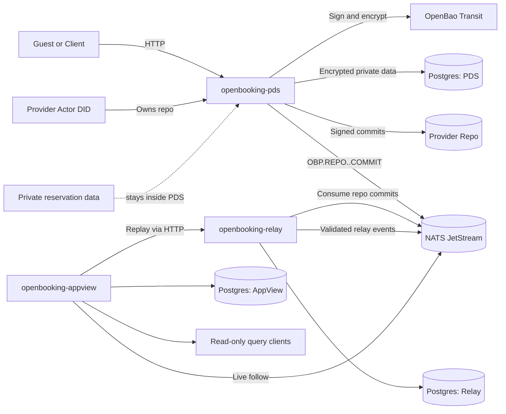

# OpenBooking

OpenBooking is a foundation implementation for an open, verifiable booking network. It
combines DID-addressed actors, append-only signed repositories, JetStream-based mesh
propagation, and a strict separation between public reservation state and private
reservation companion data.

## What It Includes

| Area | Current implementation |
| --- | --- |
| Identity | DID-based actors with direct `did:web` resolution |
| Repository | Append-only signed commits with deterministic Merkle roots |
| Public booking core | Listings, rate plans, availability, offers, intents, commits, rejects, cancels |
| Runtime | Runnable PDS, relay, and AppView binaries |
| Transport | NATS JetStream subjects for repo, intent, and relay propagation |
| Private data | Encrypted profile/contact/preference data with consent-gated reservation access |
| Operations | Health, readiness, metrics, retrying workers, relay replay, AppView catch-up |

## Documentation

- [Protocol Reference](docs/protocol.md)
- [System Architecture](docs/architecture.md)
- [Private Data Model](docs/private-data.md)
- [Network MVP Runbook](docs/network-mvp.md)

## Quick Start

OpenBooking currently ships infrastructure scaffolding plus three runnable binaries.

1. Start the backing services from [deployments/compose.yml](deployments/compose.yml).
2. Configure and run `openbooking-pds`.
3. Configure and run `openbooking-relay`.
4. Configure and run `openbooking-appview`.
5. Smoke-check the stack with [scripts/smoke-network.sh](scripts/smoke-network.sh).

The compose file currently covers infrastructure dependencies such as NATS, PostgreSQL,
and OpenBao. The application binaries are still run separately.

## Binaries

| Binary | Role | Storage | Inbound | Outbound |
| --- | --- | --- | --- | --- |
| `openbooking-pds` | Write authority for one actor DID | PostgreSQL repo, outbox, private records | HTTP, `OBP.INTENT.<did>` | `OBP.REPO.<did>.COMMIT` |
| `openbooking-relay` | Validating downstream consumer | PostgreSQL validated event log | `OBP.REPO.*.COMMIT`, HTTP replay | `OBP.RELAY.<did>.COMMIT`, `OBP.RELAY.<did>.CHECKPOINT` |
| `openbooking-appview` | Read-only projection service | PostgreSQL query models | Relay HTTP replay, `OBP.RELAY.<did>.COMMIT` | Read-only HTTP responses |

## Key Endpoints

### PDS

- `GET /healthz`
- `GET /readyz`
- `GET /metrics`
- `GET /v1/repo/head`
- `GET /v1/records/{nsid}/{rkey}`
- `GET /v1/commits?after_revision=N`
- `POST /v1/records`
- `DELETE /v1/records/{nsid}/{rkey}`
- `POST /v1/intents`
- `GET /v1/private/profile`
- `PUT /v1/private/profile`
- `PUT /v1/private/reservations/{intentId}`
- `GET /v1/private/reservations/{intentId}`
- `POST /v1/private/consents`
- `DELETE /v1/private/consents/{grantId}`

### Relay

- `GET /healthz`
- `GET /readyz`
- `GET /metrics`
- `GET /v1/status`
- `GET /v1/events?after_sequence=N&limit=M`
- `GET /v1/actors/{actorDid}/head`

### AppView

- `GET /healthz`
- `GET /readyz`
- `GET /metrics`
- `GET /v1/providers/{providerDid}/listings`
- `GET /v1/providers/{providerDid}/offers/{rkey}`
- `GET /v1/providers/{providerDid}/availability?listing_uri=&rate_plan_uri=`
- `GET /v1/providers/{providerDid}/reservations/{intentId}`

## Current Flow

1. A provider writes public booking records into its own repo through the PDS.
2. The PDS emits a signed repo commit onto JetStream.
3. The relay validates commit signatures and revision continuity, then republishes a
   relay envelope.
4. AppView replays validated relay events and projects listings, offers, availability,
   and reservation state for query clients.
5. Private reservation companion data remains inside the PDS and is exposed only through
   owner access or explicit consent grants.

## Non-Goals In This Repository

- generalized Web5 or DWN private-data interoperability
- runtime `did:plc` support
- payments, messaging, or marketplace search/ranking
- multi-tenant PDS hosting
