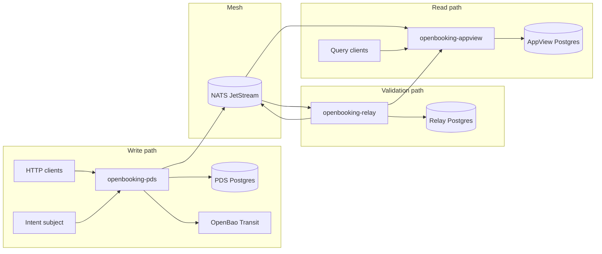
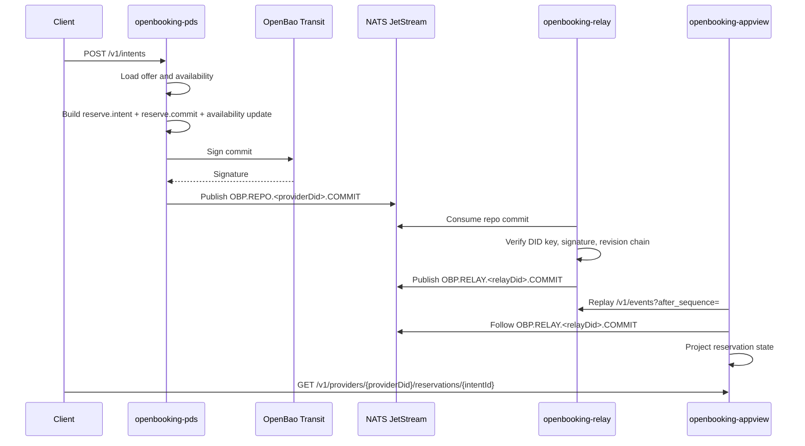

# OpenBooking Architecture

OpenBooking is organized around one authority boundary: the PDS is the write authority
for a single actor DID. Everything else is downstream validation, replay, and
projection.

## Component Boundaries

## Runtime Responsibilities

| Component | Responsibility | Authority |
| --- | --- | --- |
| `openbooking-pds` | Validates writes, builds commits, signs state, stores private records, drains outbox | Source of truth for one actor DID |
| `openbooking-relay` | Validates downstream commits, stores replay log, republishes relay envelopes | No write authority over protocol state |
| `openbooking-appview` | Rebuilds read models from relay replay and live events | Read-only projection |
| OpenBao Transit | Signing and encryption operations | Cryptographic helper only |
| NATS JetStream | Durable message transport and replay substrate | Transport, not authority |

## End-To-End Accepted Reservation

## Data Paths

| Path | Inputs | Outputs |
| --- | --- | --- |
| Write path | PDS HTTP, provider intent subject | Signed repo commits, encrypted private records |
| Validation path | Repo commit subjects | Validated relay envelopes, replay checkpoints |
| Read path | Relay replay API, relay commit subjects | Listings, offers, availability, reservation projections |

## Storage Ownership

| Store | Contents |
| --- | --- |
| PDS Postgres | Repo records, commits, outbox, consumer checkpoints, private records, consent grants |
| Relay Postgres | Validated relay events, actor heads, consumer checkpoints |
| AppView Postgres | Projection tables and replay checkpoints |

## Design Rules

- The PDS is the only component that writes protocol state for its actor DID.
- Relay and AppView can be rebuilt from downstream inputs and checkpoints.
- Private records do not leave the PDS.
- JetStream persistence helps replay and recovery, but signed repo commits remain the
  protocol truth.
