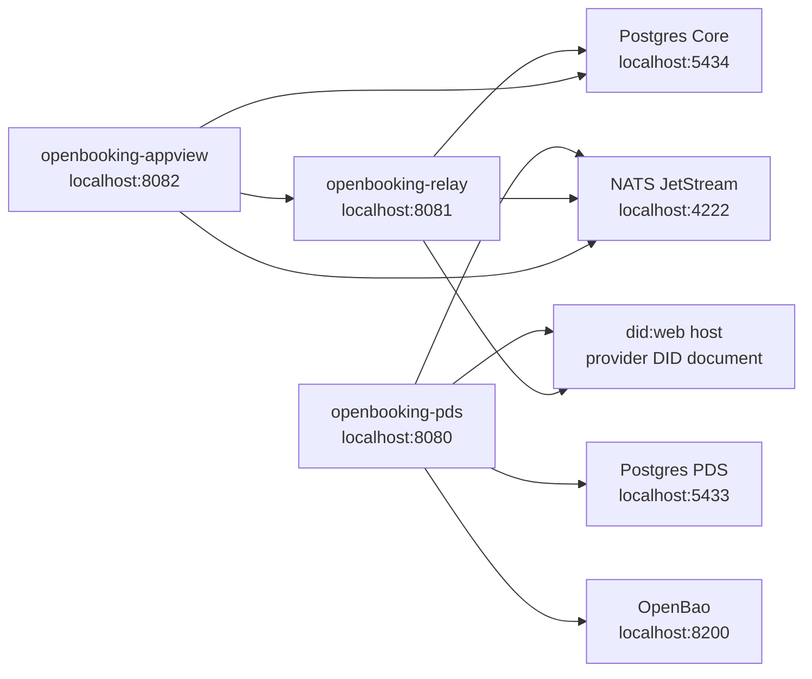
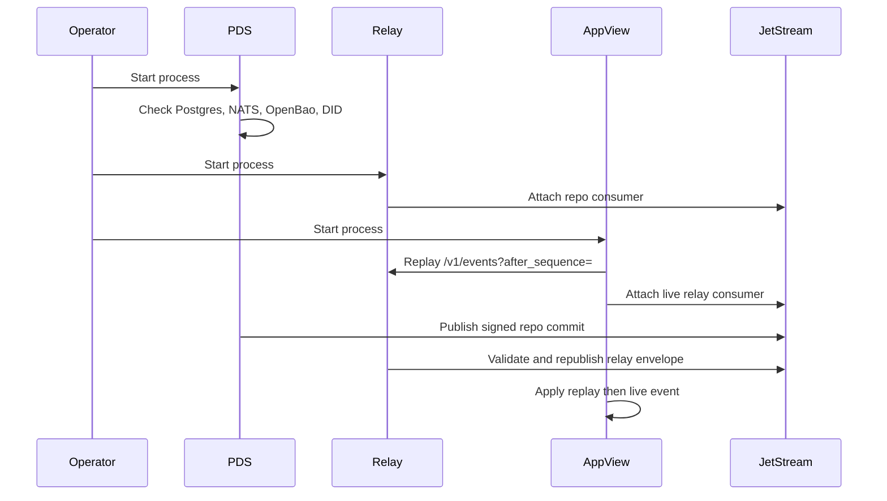

# OpenBooking Network MVP

This repository ships three runnable binaries:

- `openbooking-pds`
- `openbooking-relay`
- `openbooking-appview`

## Local Topology

The current compose file provides infrastructure dependencies:

- NATS with JetStream on `localhost:4222`
- PDS PostgreSQL on `localhost:5433`
- shared relay/AppView PostgreSQL on `localhost:5434`
- OpenBao dev server on `localhost:8200`

The application binaries are run separately.

## Startup Order

1. Start infrastructure from [deployments/compose.yml](../deployments/compose.yml).
2. Create the OpenBao Transit key used by the provider DID.
3. Serve the provider `did:web` document over HTTPS.
4. Start `openbooking-pds`.
5. Start `openbooking-relay`.
6. Start `openbooking-appview`.
7. Run [scripts/smoke-network.sh](../scripts/smoke-network.sh) after all three services
   report readiness.

## Startup And Replay Behavior

## Runtime Configuration

| Service | Required configuration |
| --- | --- |
| PDS | `OPENBOOKING_ACTOR_DID`, `OPENBOOKING_POSTGRES_DSN`, `OPENBOOKING_OPENBAO_ADDR`, `OPENBOOKING_OPENBAO_TOKEN`, `OPENBOOKING_OPENBAO_KEY_ID` |
| Relay | `OPENBOOKING_RELAY_DID`, `OPENBOOKING_RELAY_POSTGRES_DSN` |
| AppView | `OPENBOOKING_APPVIEW_POSTGRES_DSN`, `OPENBOOKING_RELAY_DID` |
| Shared | `OPENBOOKING_NATS_URL` |

Useful optional values:

- `OPENBOOKING_ACTOR_ROLE`
- `OPENBOOKING_OPENBAO_PRIVATE_KEY_ID`
- `OPENBOOKING_RELAY_HTTP_ADDR`
- `OPENBOOKING_APPVIEW_HTTP_ADDR`
- `OPENBOOKING_READY_OUTBOX_THRESHOLD`
- `OPENBOOKING_READY_REPLAY_LAG_THRESHOLD`

## Operator Checks

| Service | Health | Readiness | Metrics | Extra |
| --- | --- | --- | --- | --- |
| PDS | `GET /healthz` | `GET /readyz` | `GET /metrics` | repo and private endpoints |
| Relay | `GET /healthz` | `GET /readyz` | `GET /metrics` | `GET /v1/status`, replay APIs |
| AppView | `GET /healthz` | `GET /readyz` | `GET /metrics` | provider query APIs |

## Smoke Flow

1. Seed the provider repo with:
   - `catalog.listing`
   - `catalog.ratePlan`
   - `inventory.availability`
   - `offer.quote`
2. Submit `POST /v1/intents` to the provider PDS.
3. Confirm the PDS writes a terminal reservation result.
4. Confirm relay replay exposes the validated commit from `GET /v1/events`.
5. Confirm AppView exposes the resulting reservation state from
   `GET /v1/providers/{providerDid}/reservations/{intentId}`.
6. Optionally store and read reservation-linked private data through the PDS private
   endpoints using `X-OpenBooking-Actor-DID`.
