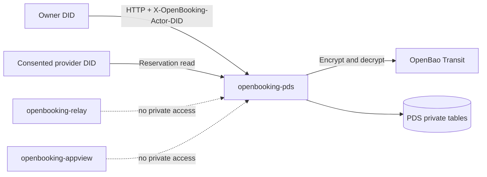
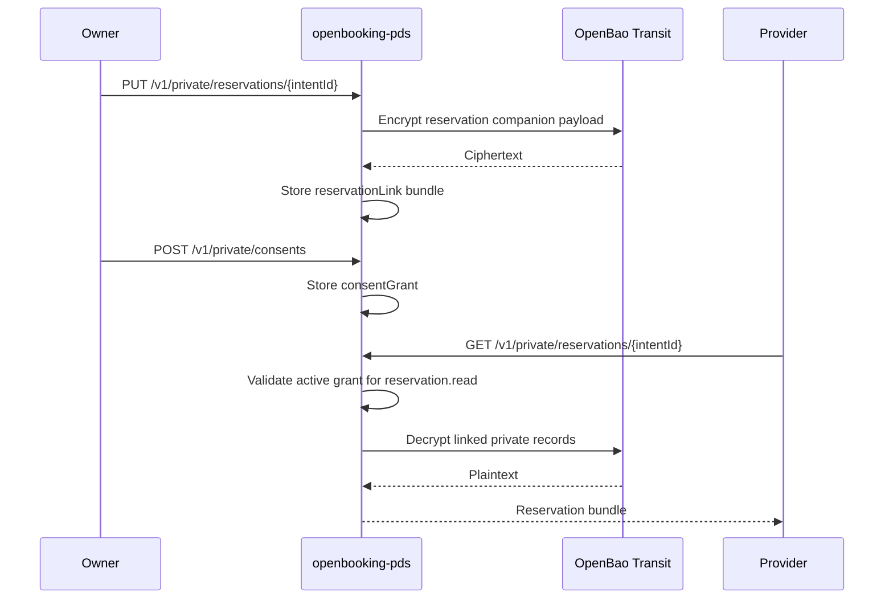

# OpenBooking Private Data Model

OpenBooking keeps private reservation companion data off the public mesh. The current
implementation stores private records only in the PDS, encrypted at rest through
OpenBao Transit.

## Private Boundary

## Private Record Families

| NSID | Purpose | Notes |
| --- | --- | --- |
| `com.openbooking.private.profile` | Guest profile payload | Stored under `rkey=self` |
| `com.openbooking.private.contact` | Contact details | Stored under `rkey=self` |
| `com.openbooking.private.preference` | Preference details | Stored under `rkey=self` |
| `com.openbooking.private.consentGrant` | Scoped access grant | Used to authorize non-owner reads |
| `com.openbooking.private.reservationLink` | Private bundle linked to a public reservation | Stored under `rkey={intentId}` |

## Access Model

- Requests identify the caller with `X-OpenBooking-Actor-DID`.
- The owner DID always has access to its private profile and reservation-linked private
  data.
- A non-owner can read reservation-linked private data only through an active consent
  grant with resource `reservation:{intentId}` and scope `reservation.read`.
- Relay and AppView never ingest, store, or return private payloads.

## Consent Flow

## HTTP Surface

| Endpoint | Purpose |
| --- | --- |
| `GET /v1/private/profile` | Read owner profile, contact, and preference bundle |
| `PUT /v1/private/profile` | Upsert owner profile, contact, and preference bundle |
| `PUT /v1/private/reservations/{intentId}` | Upsert reservation-linked private bundle |
| `GET /v1/private/reservations/{intentId}` | Read reservation-linked private bundle |
| `POST /v1/private/consents` | Create a consent grant |
| `DELETE /v1/private/consents/{grantId}` | Revoke a consent grant |

## What Stays Public

Public booking records keep only the reservation envelope: references, lifecycle state,
hashes, timestamps, and actor identifiers. Private profile details, contact details,
preferences, and reservation companion payloads remain outside relay and AppView.
