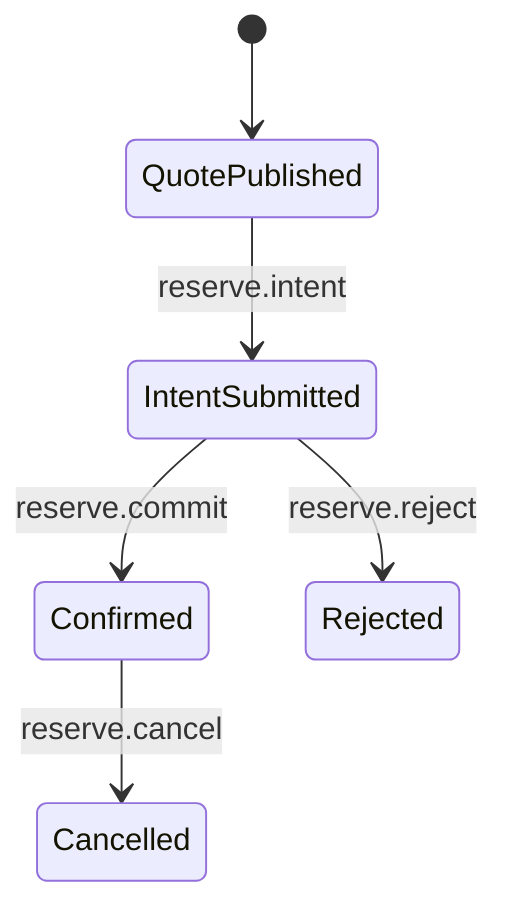
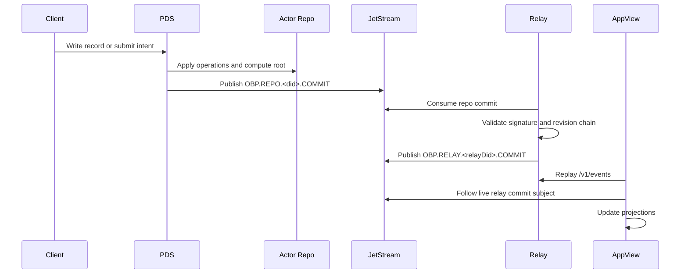

# OpenBooking Protocol v1 Foundation

## Core Model

OpenBooking uses per-actor repositories identified by DIDs. Every repository mutation
produces a signed commit, and each commit references a deterministic Merkle root over
repository records. Downstream consumers can validate signatures, revision continuity,
and repository state independently.

## Identity

| Topic | Current behavior |
| --- | --- |
| Actor identifier | DID |
| Direct runtime support | `did:web` |
| Extensibility | Other methods can be plugged in through the resolver interface |
| Verification material | DID document verification methods for Ed25519 keys |

Canonical record references use `ob://<did>/<nsid>/<rkey>`.

## Public Record Families

| NSID | Purpose |
| --- | --- |
| `com.openbooking.actor.profile` | Public actor profile |
| `com.openbooking.catalog.listing` | Listing definition |
| `com.openbooking.catalog.ratePlan` | Commercial plan attached to a listing |
| `com.openbooking.inventory.availability` | Versioned sellable inventory |
| `com.openbooking.offer.quote` | Signed commercial offer reference |
| `com.openbooking.reserve.intent` | Booking request envelope |
| `com.openbooking.reserve.commit` | Confirmed booking envelope |
| `com.openbooking.reserve.reject` | Rejected booking envelope |
| `com.openbooking.reserve.cancel` | Cancellation envelope |

Reservation records use a public-envelope model. Public records carry references,
hashes, lifecycle state, timestamps, and actor identifiers. PII and payment fields are
intentionally absent from the public schemas in this repository.

## Commit Model

Each repo mutation produces a commit with actor identity, revision linkage, Merkle root,
operation list, timestamp, and signature. Consumers validate:

- DID-backed signature correctness
- monotonic per-actor revision order
- `prev` linkage between commits
- deterministic repository root reconstruction

## Transport Subjects

| Subject | Role |
| --- | --- |
| `OBP.IDENTITY.<did>` | Identity-related actor messages |
| `OBP.REPO.<did>.COMMIT` | Signed repo commit propagation |
| `OBP.INTENT.<did>` | Provider intent ingress |
| `OBP.RELAY.<did>.COMMIT` | Validated relay envelopes |
| `OBP.RELAY.<did>.CHECKPOINT` | Relay checkpoint updates |

JetStream provides durable storage and replay for these subjects, but the protocol
payloads remain transport-independent commit and envelope shapes.

## Reservation Lifecycle

Provider nodes process reservation intents deterministically against current repo state:

- accept path: `reserve.intent`, `reserve.commit`, and updated
  `inventory.availability` are written in one signed commit
- reject path: `reserve.intent` and `reserve.reject` are written in one signed commit
- terminal reservation records use `intentId` as their `rkey`

## Public Event Propagation

## Private Companion Data

Private companion data stays off-mesh and lives only inside the actor PDS. The current
private record families are:

- `com.openbooking.private.profile`
- `com.openbooking.private.contact`
- `com.openbooking.private.preference`
- `com.openbooking.private.consentGrant`
- `com.openbooking.private.reservationLink`

These records are encrypted at rest, are never published to relay subjects, and are not
projected by AppView. See [Private Data Model](private-data.md).

## Relay And AppView

Relay nodes consume `OBP.REPO.*.COMMIT`, validate signatures and per-actor revision
continuity, store validated envelopes, and republish them on
`OBP.RELAY.<did>.COMMIT`.

AppView nodes rebuild query models from relay replay and live relay events. They remain
read-only and do not write protocol state.
